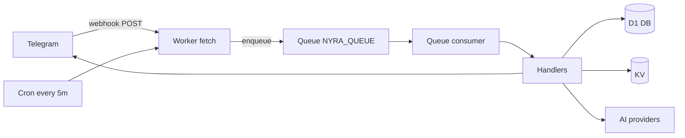

# Architecture

This page describes the **current** Nyra Worker architecture as implemented on the default branch. It does not document planned or speculative features.

## High-level overview

Nyra is a single Cloudflare Worker process. Telegram updates are accepted over HTTP, acknowledged quickly, and processed through a Cloudflare Queue so webhook latency stays low. Long-running work (AI calls, deliveries) happens in queue consumers and cron triggers.

## Entry point

- **File:** [`src/index.ts`](https://github.com/MHDLabs/Nyra/blob/main/src/index.ts)
- Exports the Workers `fetch`, `scheduled`, and `queue` handlers.
- Validates mandatory secrets before serving traffic (`validateSecrets` in [`src/crypto.ts`](https://github.com/MHDLabs/Nyra/blob/main/src/crypto.ts)).
- Ensures D1 schema / migrations via [`src/db`](https://github.com/MHDLabs/Nyra/tree/main/src/db).

## HTTP surface

Typical routes (see Worker entry and routers):

| Path | Role |
|------|------|
| Telegram webhook path | Enqueue updates |
| `/setup` | One-time / ops setup (secret-gated) |
| `/status` | Health / configuration status |
| `/api/*` | Mini App JSON API ([`src/miniapp/`](https://github.com/MHDLabs/Nyra/tree/main/src/miniapp)) |
| `/admin-panel`, `/admin-api/*` | External admin panel ([`src/admin-panel/`](https://github.com/MHDLabs/Nyra/tree/main/src/admin-panel)) |
| Static assets | Mini App UI under [`public/`](https://github.com/MHDLabs/Nyra/tree/main/public) |

Exact route tables live in the entry composition root and the Mini App / admin routers—prefer those files over this summary when implementing changes.

## Update processing

1. Telegram delivers an update to the webhook.
2. The Worker persists / deduplicates as designed and enqueues work on `NYRA_QUEUE`.
3. The queue consumer runs handler logic ([`src/handlers/`](https://github.com/MHDLabs/Nyra/tree/main/src/handlers)): fast path, callbacks, commands, AI turns.
4. Outbound Telegram calls go through [`src/telegram.ts`](https://github.com/MHDLabs/Nyra/blob/main/src/telegram.ts).
5. Permanently failed updates can be recorded for admin review ([`src/dlq.ts`](https://github.com/MHDLabs/Nyra/blob/main/src/dlq.ts)).

Conversation ordering uses chat-scoped keys so updates in the same chat stay serialized where required.

## Major modules

| Area | Location | Responsibility |
|------|----------|----------------|
| Config / constants | `src/config.ts` | Limits, prompts, default personalities |
| Utilities | `src/utils.ts` → `src/utils/*` | Text, admin IDs, rate limits, encoding |
| Crypto | `src/crypto.ts` | Master key, AES-256-GCM credential seal/open |
| Redaction | `src/redact.ts` | Log-safe scrubbing of secrets and admin IDs |
| Database | `src/db/`, `src/db.ts` | Schema, migrations, queries |
| Providers | `src/providers/` | OpenAI-compatible and Anthropic clients, streaming, fallback |
| Brain / memory | `src/brain.ts`, `src/memory.ts` | Prompt assembly, memory modes |
| Commands / menus | `src/commands.ts`, `src/menus.ts` | User and admin Telegram UX |
| Web search | `src/websearch.ts` | Zero-key HTML search helpers |
| Reminders / schedules | `src/reminders/`, `src/schedules/` | Due delivery from cron |
| Voice | `src/voice/` | Speech-related helpers |
| Formatting | `src/formatter.ts`, `src/markdown.ts` | Telegram-safe rendering and chunking |

## Storage and bindings

Configured in [`wrangler.toml`](https://github.com/MHDLabs/Nyra/blob/main/wrangler.toml):

- **D1 (`DB`)** — primary relational state
- **KV (`KV`)** — short-lived markers, rate-limit style data, caches
- **Queues (`NYRA_QUEUE`, DLQ-related bindings as configured)** — async update processing
- **Workers AI (`AI`)** — used for limited on-platform tasks (for example reaction-related classification)
- **Assets** — static Mini App files

## Secrets (mandatory)

Deployments require manually set secrets (never committed):

- `TELEGRAM_BOT_TOKEN`
- `TELEGRAM_SECRET` (webhook / setup authentication)
- `ENCRYPTION_KEY` (32-byte key, base64; wraps stored provider credentials)

Missing or malformed secrets cause the Worker to refuse traffic.

## Cron

A `*/5 * * * *` trigger runs operational tasks such as webhook re-verification probes, reminder/schedule delivery, proactive check-ins, and DLQ-related maintenance—as implemented in the scheduled handler path.

## Testing and types

- Tests: `test/` using Node’s test runner (`npm run test:all`)
- TypeScript: Worker and web projects (`npm run typecheck`)
- Engineering history: [`docs/engineering/`](https://github.com/MHDLabs/Nyra/tree/main/docs/engineering)

## Related reading

- [Home](Home)
- [Security](Security)
- [CONTRIBUTING.md](https://github.com/MHDLabs/Nyra/blob/main/CONTRIBUTING.md)
